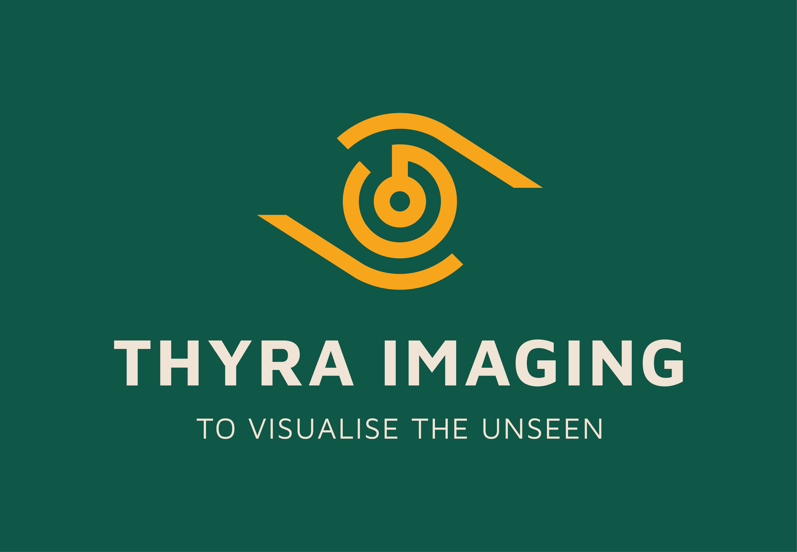

  

<em>To visualise the unseen.</em>

---

## About us

**Thyra Imaging** is a medical-imaging company based in Austria. We build machine-learning tools that make the cellular detail in high-resolution retinal images visible and measurable.

Our current focus is **automatic detection of retinal microglia** in 3D *in vivo* **Adaptive Optics Optical Coherence Tomography (AO-OCT)** images of the human retina. 

Today, we do this work manually, which is slow and can vary from annotator to annotator. We want it to be fast, reproducible, and ready for clinical research, while expanding the system's reach. 

## What we work on

- **Image quality assessment:** measuring how usable each AO-OCT volume is for cell-level analysis (focus, contrast, noise, artefacts).
- **Annotation review:** tools to check and improve the reliability of expert annotations used as training data.
- **ML-based cell detection:** models that find microglia in 3D retinal volumes.
- **Visualisation tools:** software for inspecting 3D images alongside their annotations.

## Data and privacy

We work with clinical imaging data under strict data-protection agreements. **No patient images or annotations are stored in our public repositories.** Code is shared here; data is not.

## Get in touch

- 🌐 Website: [https://thyra-imaging.com/](https://thyra-imaging.com/)
- ✉️ Email: [contact@thyra-imaging.com](mailto:contact@thyra-imaging.com)
- 💼 LinkedIn: [link](https://www.linkedin.com/company/thyra-imaging)

Interested in collaborating on retinal imaging or ophthalmic AI? We'd love to hear from you.
