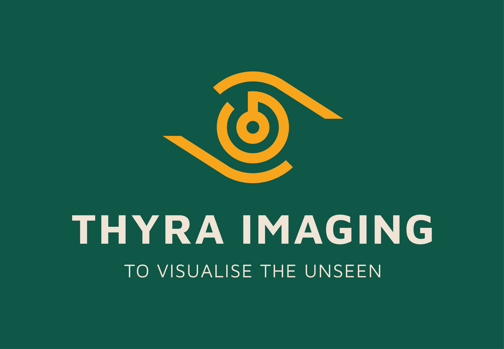

  

<em>To visualise the unseen.</em>

---

## About us

**Thyra Imaging** is a medical-imaging company based in Austria. We build machine-learning tools that make the cellular detail in high-resolution retinal images visible and measurable.

Our current focus is **automatic detection of retinal microglia** in 3D *in vivo* **Adaptive Optics Optical Coherence Tomography (AO-OCT)** images of the human retina. 

Today, we do this work manually, which is slow and can vary from annotator to annotator. We want it to be fast, reproducible, and ready for clinical research, while expanding the system's reach. 

## What we work on

We are a pre-seed spin-off of MedUni Vienna, building on an AO-OCT lab prototype developed there over 10 years and already used with patients.

- **Thyra-ONE:** a compact AO-OCT research device that captures a 3D retinal volume at 2 µm resolution in about 2.5 s. It uses a pyramid wavefront sensor from astronomy, and works through moderate cataract and lens implants. Target: Q1 2028.
- **Thyra-AI:** models that detect retinal microglia and classify them as resting or activated, trained on annotated AO-OCT scans from MedUni Vienna. Target: 2028.
- **Image quality and visualisation tools:** checks on how usable each volume is for cell-level analysis and how reliable the expert labels are, plus software for inspecting 3D volumes alongside their annotations.

## Data and privacy

We work with clinical imaging data under strict data-protection agreements. **No patient images or annotations are stored in our public repositories.** Code is shared here; data is not.

## Get in touch

- 🌐 Website: [https://thyra-imaging.com/](https://thyra-imaging.com/)
- ✉️ Email: [contact@thyra-imaging.com](mailto:contact@thyra-imaging.com)
- 💼 LinkedIn: [link](https://www.linkedin.com/company/thyra-imaging)

Interested in collaborating on retinal imaging or ophthalmic AI? We'd love to hear from you.
